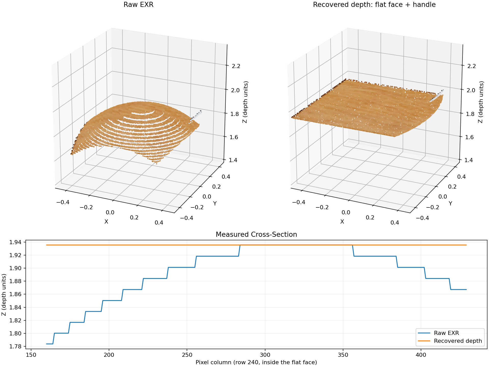

# Legacy ShapeNetSem Depth Correction

## Overview

The original ShapeNetSem depth maps contain a systematic distortion introduced during rendering. Instead of representing true axial camera depth, the stored EXR values were multiplied by a quantized, sRGB-decoded cosine correction map.

This distortion introduces artificial curvature and banding into reconstructed 3D geometry, even on surfaces that should be planar.

The correction reconstructs the original multiplier and divides it out to recover axial depth. It is applied independently to each pixel, without smoothing, fitting surfaces, or modifying the underlying geometry.



The presented results can be reproduced using:
```bash
uv run code/scripts/diagnose_dataset_depth.py \
  --dataset-root /path/to/ShapeNetSem/data
```

## Origin of the Distortion

Investigation of the original Blender rendering script `render_blender.py` in the [ShapeNetSem](https://github.com/RavineWindteer/ShapenetSem-to-RGBD) repository identified two relevant issues.

### 1. Incorrect Correction Map Encoding

The rendering pipeline constructed a cosine correction map intended to compensate for the relationship between radial distance and axial camera depth.

However, the correction image was created without enabling floating-point storage or marking it as non-color data. At line 122, `bpy.data.images.new(...)` omits `float_buffer=True` and `is_data=True`, but both default to `False` in the [Blender 2.90 API](https://docs.blender.org/api/2.90/bpy.types.BlendDataImages.html), resulting in an 8-bit color image. Consequently, as per the [Blender compositor documentation](https://docs.blender.org/manual/en/3.1/compositing/types/converter/color_space.html), the correction values were quantized and converted from sRGB to linear values during compositing.

### 2. Inconsistent Camera Intrinsics

The renderer’s final camera is assigned `lens=35` and `sensor_width=32`, overriding the `angle=57°` and `fx=fy=588` configuration set earlier in the code, resulting in an actual focal length of `fx=fy=700`. However, the correction map was generated using the earlier focal length, resulting in a discrepancy in intrinsics between the correction map and camera geometry.

## Depth Correction

For the original 640 × 480 depth maps, the cosine correction is calculated as:

$$
c(u,v) =
\frac{1}{
\sqrt{
1+\left(\frac{u-320}{588}\right)^2+
\left(\frac{v-240}{588}\right)^2
}
}
$$

The values are then quantized to 8-bit precision:

$$
q(u,v) = \frac{\lfloor 255c(u,v)+0.5 \rfloor}{255}
$$

Finally, the sRGB-to-linear transformation is applied:

$$
F(u,v) =
\begin{cases}
\frac{q(u,v)}{12.92}, & q(u,v) \leq 0.04045 \\[6pt]
\left(\frac{q(u,v)+0.055}{1.055}\right)^{2.4}, & q(u,v)>0.04045
\end{cases}
$$

The original axial depth is recovered by dividing the stored depth values by this multiplier. The recovered depth maps can be backprojected into 3D camera coordinates using the actual rendering focal length of 700 pixels.

## Numerical Validation

The correction was validated by examining planar surfaces in the point clouds reconstructed from various views of the object `1da9362bcaa79e65136d9cfd13835101` in the dataset, which corresponds to a cabinet.

For an interior region of a cabinet's top surface, the following depth variations were measured:

| Method | Standard Deviation | Peak-to-Peak |
|---|---:|---:|
| Original EXR | 0.0533716 | 0.264866 |
| Quantized sRGB correction | **2.28 × 10⁻⁷** | **8.09 × 10⁻⁷** |

The cabinet's left face also becomes flat (standard deviation about 2.23 × 10⁻⁷), support the proposed correction.

However, planarity by itself cannot help in diagnosing the focal length discrepancy, as changing X/Y scale preserves planes. 

The three faces in cabinet's `r_045` view were selected using the row/column slices `210:330,215:290`, `180:350,365:440`, and `65:95,280:380`. Plane normals were computed for each face using the smallest eigenvector of each centered point covariance matrix, with recovered plane RMS errors of 0.000251, 0.000230, and 0.000173. With focal length 700, the acute angles between these faces are **89.973°, 89.973°, 89.965°**, while with 588 they are **82.195°, 83.479°, 83.471°**. Assuming the cabinet faces are perpendicular, this independently supports 700.

## Applying the Correction

The correction is implemented in `code/utils/legacy_depth_correction.py` and integrated into the corrected-depth dataset pipeline.

It can also be applied directly:

```python
from utils.exr import read_exr_red
from utils.legacy_depth_correction import (
    backproject_z,
    correct_legacy_depth,
)

raw = read_exr_red("object_top_depth0001.exr")

depth_z = correct_legacy_depth(raw)
xyz = backproject_z(depth_z)

points = xyz[depth_z > 0]
```

The correction must be applied:

1. At the original 480 × 640 resolution.
2. Before resizing, cropping, or other geometric augmentations.
3. Before depth normalization.
4. Exactly once per depth map.

## Limitations

Although it recovers the underlying axial depth values, it cannot reconstruct information already lost through depth quantization, clipping, or missing geometry.